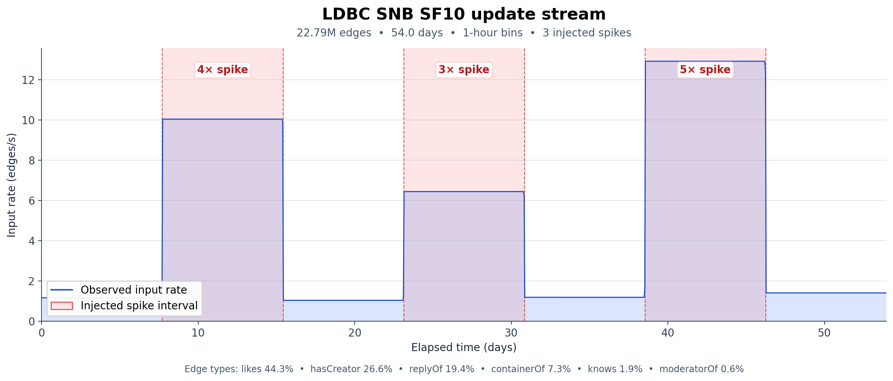
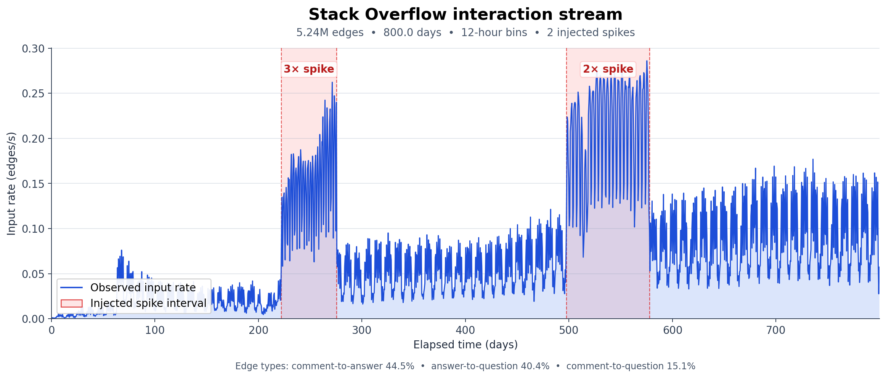

# Temporal Shedding for Continuous Regular Path Queries

## Additional materials

### Dataset input rates

The experiments use timestamp-ordered graph streams with synthetic high-load intervals. The shaded regions below mark the injected input-rate spikes while preserving the edges and their labels.

#### LDBC

The LDBC SNB SF10 update stream contains 22.79 million edges over 54.0 days. It includes three sustained spike intervals generated with 4×, 3×, and 5× rate multipliers.



#### Stack Overflow

The Stack Overflow stream contains 5.24 million answer and comment edges over 800 days. Timestamp compression introduces two spike intervals at 3× and 2× while retaining the original interactions and overall duration.



#### Comparison vs ADWIN


ADWIN maintains stable load-estimation values across all delta configurations for both datasets, demonstrating its design goal of preserving the stability of the input distribution. However, because the estimation is overly influenced by the window size, it no longer guides window adaptation to the workload, resulting in small windows. Because ADWIN prioritizes maintaining statistical stability, the resulting windows do not provide sufficient time for edges to form meaningful graph structures and connections. Indeed, the inability to specify a window size makes ADWIN unsuitable for scaling to realistic streaming graph-processing workloads.

#### LDBC schema

The LDBC (Linked Data Benchmark Council) schema is a standard for representing and querying linked data. It defines a set of classes, properties, and relationships that can be used to model real-world scenarios.

| Label | Relationship and direction | Source operation | SF30 edges |
|---|---|---|---:|
| 1 | knows: Person → Person | 8, addFriendship | 1,304,053 |
| 2 | likes: Person → Post or Comment | 2, addPostLike; 3, addCommentLike | 30,492,376 |
| 3 | replyOf: Comment → Post or Comment | 7, addComment | 12,588,582 |
| 4 | hasCreator: Post or Comment → Person | 6, addPost; 7, addComment | 16,893,029 |
| 5 | moderatorOf: Person → Forum | 4, addForum | 330,288 |
| 6 | containerOf: Forum → Post | 6, addPost | 4,304,446 |

## Repository layout

- `CMakeLists.txt`: C++17 build for the `main_exe` target. Release optimization (`-O3`) and assertions disabled (`-DNDEBUG`) are currently applied globally.
- `code/main.cpp`: program setup, filtered stream loop, mode dispatch, and CSV output.
- `code/source/fsa.h`: built-in RPQ automata selected by `query_type`.
- `code/source/query_processor.h`: common query-processor interface and the S-PATH/LM-SRPQ factory.
- `code/source/S-PATH.h`: prefix-spanning-tree RPQ maintenance, including explicit repair after mid-window edge shedding.
- `code/source/LM-SRPQ.h`: landmark-aware RPQ maintenance and dynamic landmark selection.
- `code/source/streaming_graph.h`: active graph, forward and reverse adjacency lists, edge-ID index, degree counters, and timestamp-ordered edge list.
- `code/source/modes/`: fixed/adaptive sliding windows, probabilistic load shedding, ranked shedding, and the experimental ADWIN handler.
- `code/source/ranking/`: rank buckets used by ranked shedding.
- `code/dataset/`: input streams, preprocessing utilities, and dataset plots.
- `code/benchmark/config/`: benchmark configurations grouped by experiment.
- `code/benchmark/results/`: retained CSV results and generated figures.
- `code/scripts/evaluation/`: evaluation, comparison, and plotting scripts.
- `run_benchmark.sh`: recursive sequential runner for a configuration directory.
- `code/benchmark/run_isolated_benchmarks.py`: resource-isolated multi-job benchmark launcher.

## Build

The executable requires CMake 3.10 or newer and a C++17 compiler.

```bash
cmake -S . -B build -DCMAKE_BUILD_TYPE=Release
cmake --build build --target main_exe
```

The resulting executable is `build/main_exe`.

## Run

Run the executable from the repository root with a configuration path as its first argument:

```bash
./build/main_exe code/config.txt
```

Relative `input_data_path` and `output_folder` values are resolved from the process working directory. Running from another directory therefore requires adjusted paths.

To build once and execute every `.txt` configuration below a directory recursively:

```bash
./run_benchmark.sh code/benchmark/config/sigmod/ldbc_sf10
```

The batch runner builds `build-benchmark/main_exe`, writes standard output and error to `logs/<config-name>.log` and `.err`, continues after individual failures, and returns a failure status if any run fails. Set `DEBUG=1` to build with debug information and AddressSanitizer.

## Input stream format

Each non-empty record must contain four whitespace-separated integers:

```text
source destination label timestamp
```

Timestamps must be non-decreasing. The engine subtracts the first stream timestamp and performs windowing on this relative time. Records with labels absent from the selected automaton are skipped before graph or query processing.

The active graph stores at most one edge for a `(source, destination, label)` triple. Repeating an active triple refreshes its timestamp and reprocesses it through the selected query algorithm.

## Configuration format

Configuration files use one `key=value` pair per line. Keys and values are not trimmed, so do not put spaces around `=`. Blank lines and full lines without `=` are ignored; unknown keys are also ignored. In particular, the old `rate_volatility` key is not consumed by the current implementation.

### Adaptive-window example

```ini
mode=11
input_data_path=code/dataset/ldbc/ldbc_updatestream_sf10_peaks_sustained.txt
size=259200
slide=21600
query_type=5
labels=4,1,2
path_algorithm=2
max_size=259200
min_size=129600
min_variation=0.0075
load_average_horizon=25
normalization_horizon=0
output_folder=results/ldbc_q5
```

### Configuration parameters

| Key | Type | Required | Current behavior |
|---|---|---|---|
| `input_data_path` | Path | Always | Input edge stream. Relative paths use the current working directory. |
| `mode` | Integer | Always | Selects the window or shedding handler listed below. |
| `size` | Integer | Always | Fixed or initial window width in timestamp units. Must be positive in normal sliding/adaptive use. |
| `slide` | Integer | Always | Window-opening and measurement step in timestamp units. Must be positive. `size == slide` produces tumbling windows. |
| `query_type` | Integer | Always | Selects one of the built-in automata. |
| `labels` | Integer list | Always | Comma-separated label IDs in the positional order required by the automaton. |
| `path_algorithm` | Integer | Always | `1` selects S-PATH; `2` selects LM-SRPQ. |
| `max_size` | Integer | Modes `10`–`15` | Upper adaptive bound. It is parsed but unused by fixed mode `10`, where the established convention is `0`. |
| `min_size` | Integer | Modes `10`–`15` | Lower adaptive bound. It is parsed but unused by fixed mode `10`, where the established convention is `0`. Must not exceed `max_size`. |
| `min_variation` | Float | Optional, modes `11`–`15` | Resize threshold for the change in smoothed normalized cost. Valid range `(0, 1]`; effective default is `0.02`. |
| `load_average_horizon` | Integer | Optional, modes `11`–`15` | Number of normalized-cost observations in the moving average. A missing or zero value uses integer overlap `size / slide`. |
| `normalization_horizon` | Integer | Optional, modes `11`–`15` | Rolling min/max horizon for raw-cost normalization. `0` (default) uses all observed history. |
| `granularity` | Float | Modes `3`, `4` | Required and included in the output filename. The current controllers do not otherwise use this value. |
| `max_shed` | Float | Modes `3`, `4` | Maximum probability for adaptive shedding in mode `3`; fixed shedding probability in mode `4`. Configurations use fractions such as `0.08`. |
| `l_max` | Float | Mode `5` | Required by the parser and printed at startup. See the mode `5` limitation below. |
| `output_folder` | Path | Optional | Destination for generated CSV files; defaults to `results`. |

The parser does not comprehensively validate positive sizes, positive slides, label count, probability bounds, or the existence of every core key. Use the constraints above when producing configurations.

## Window and shedding modes

| `mode` | Output tag | Cost or policy | Status |
|---:|---|---|---|
| `10` | `sl` | Fixed-width sliding or tumbling window. | Active |
| `11` | `ad_function` | `E_init × E`, called `nm` in the functions CSV. | Active |
| `12` | `ad_degree` | Average degree `E / V`. | Active |
| `13` | `ad_einit` | LEF: `(E_init + 1)(2E - E_init) / 2`. | Active |
| `14` | `maxdeg` | Maximum active-window out-degree. | Active |
| `15` | `ad_complexity` | ALEF: `LEF / max_degree`. | Active |
| `2` | `adwin` | ADWIN over a normalized graph-cost signal. | Experimental; incomplete through `main_exe` |
| `3` | `lshed_prob` | Random pre-insertion shedding with an adaptive probability. | Active |
| `4` | `lshed_random` | Random pre-insertion shedding with fixed probability `max_shed`. | Active |
| `5` | `lshed_darling` | Degree-ranked mid-window shedding. | Experimental; incomplete budget wiring |

Here `E` is the active edge count, `V` is the active vertex count, and `E_init` counts active edges whose labels leave the automaton's initial state.

For modes `11`–`15`, the selected raw cost is min/max normalized over either all history or `normalization_horizon` observations. The engine averages the normalized values over `load_average_horizon`, compares the average with the preceding average, and changes the window by one `slide` for each complete `min_variation` step. A cost increase shrinks the window; a decrease expands it. The result is clamped to `[min_size, max_size]`.

Mode `3` applies the mode `11` estimator at window eviction, adds the signed normalized-cost change to `p_shed`, and clamps the probability to `[0, max_shed]`. Mode `4` independently drops each eligible incoming edge with probability `max_shed`.

Mode `2` is not currently usable as a supported command-line configuration: `min_size` is only read for modes `10`–`15`, while ADWIN derives `delta` from `min_size`, and the handler still writes through the disabled tuple-output stream. Mode `5` parses `l_max`, but `main.cpp` does not copy it into the handler's latency-budget field. Treat both modes as implementation prototypes until those paths are completed.

## Path algorithms

| `path_algorithm` | Name | Current behavior |
|---:|---|---|
| `1` | S-PATH | Maintains prefix spanning trees over the product graph. On ranked mid-window deletion, it searches the reverse adjacency list for a surviving parent and removes a subtree only when reconnection fails. |
| `2` | LM-SRPQ | Maintains ordinary and landmark trees. Normal expiration is followed by dynamic landmark selection with candidate rate `0.2` and benefit threshold `1.5`. |

LM-SRPQ has no dedicated mid-window `shed_edges` implementation. Its adapter currently passes explicitly deleted edges to the ordinary expiration routine with cutoff `0`; it does not run dynamic landmark selection from that shedding callback.

## Supported queries

`labels` maps pattern symbols by position. For example, `query_type=10` with `labels=3,4,1` instantiates `(3|4)1*`.

| `query_type` | Pattern | Label count | Accepted form |
|---:|---|---:|---|
| `1` | `a+` | 1 | One or more `a` edges. |
| `2` | `ab*` | 2 | One `a`, followed by zero or more `b` edges. |
| `3` | `ab*c*` | 3 | One `a`, then zero or more `b`, then zero or more `c` edges. |
| `4` | `(abc)+` | 3 | One or more repetitions of `abc`. |
| `5` | `ab*c` | 3 | One `a`, zero or more `b`, and one `c`. |
| `6` | `a*b*` | 2 | A non-empty sequence with all `a` edges before all `b` edges. |
| `7` | `abc*` | 3 | One `a`, one `b`, then zero or more `c` edges. |
| `8` | `(a\|b)+c` | 3 | One or more `a`/`b` edges followed by one `c`. |
| `9` | `ab+c` | 3 | One `a`, one or more `b`, and one `c`. |
| `10` | `(a\|b)c*` | 3 | One `a` or `b`, followed by zero or more `c` edges. |

## Generated CSV files

Every run opens four CSV files below `output_folder`:

- `*_summary_results.csv`
- `*_window_results.csv`
- `*_slides_results.csv`
- `*_functions_results.csv`

For fully named modes, the base filename is:

```text
{dataset}_{query_type}_{size}_{slide}_{mode_tag}_{path_algorithm}_{param1}_{param2}
```

`dataset` is the name of the input file's parent directory, such as `ldbc` or `so`. The final parameters are `0_0` for mode `10`, `{min_size}_{max_size}` for modes `11`–`15`, and rounded whole percentages `{granularity}_{max_shed}` for modes `3` and `4`. Modes `2` and `5` do not currently construct a base filename and therefore write generic names beginning with `_`; repeated runs can overwrite each other.

### Summary results

```text
total_edges,matches,total_matches,exec_time,windows_created,avg_window_cardinality,avg_window_size
```

| Column | Meaning |
|---|---|
| `total_edges` | Query-relevant edge insertions admitted to the graph handler. Edges dropped before insertion by modes `3`/`4` are excluded. |
| `matches` | Cumulative count of distinct `(source, destination)` pairs first added to the sink. |
| `total_matches` | Count of every sink insertion, including repeated occurrences for an existing pair. |
| `exec_time` | Process CPU time in whole seconds. |
| `windows_created` | Number of windows retained in the final window vector. Adaptive shrink can remove provisional windows. |
| `avg_window_cardinality` | Total recorded edge-window memberships divided by the final number of retained windows. |
| `avg_window_size` | Mean configured window width sampled while admitted edges are processed. |

### Window results

```text
window_id,t_open,t_close,normalized_estimated_cost,window_results,incremental_matches,latency,window_cardinality,window_size
```

| Column | Meaning |
|---|---|
| `window_id` | Position in the final retained window vector. |
| `t_open`, `t_close` | Window bounds on the relative timestamp axis. Membership is `[t_open, t_close)`. |
| `normalized_estimated_cost` | Stored window cost. It is the smoothed normalized estimator in modes `11`–`15`; fixed mode `10` stores raw `E_init × E`. |
| `window_results` | Difference between the sink's distinct-pair counters recorded at window close and open. |
| `incremental_matches` | Legacy cumulative-match snapshot stored in `window.total_matched_results`; it is populated when a later-closing window is appended and is not a duplicate of `window_results`. |
| `latency` | Process CPU seconds from window construction to eviction. Discarded adaptive windows use `-1`; still-open windows can remain `0`. |
| `window_cardinality` | Number of admitted edge memberships assigned to the window. |
| `window_size` | `t_close - t_open`. |

### Slide results

```text
t_open,t_close,latency_sec,elements,new_results,cost_norm
```

| Column | Meaning |
|---|---|
| `t_open`, `t_close` | Slide interval on the relative timestamp axis. |
| `latency_sec` | Process CPU time between opening this slide record and opening the next one, or reaching end of input. |
| `elements` | Admitted query-relevant edges observed in the slide. |
| `new_results` | Difference between distinct-pair sink counters at slide close and open. |
| `cost_norm` | Current normalized cost copied into the slide record at its boundary. |

### Functions results

```text
alef,avg_deg,lef,max_deg,nm
```

The columns are written whenever `compute_load_estimation` runs:

- `lef = (E_init + 1)(2E - E_init) / 2`
- `alef = lef / max_deg`
- `avg_deg = E / V`
- `max_deg` is the maximum out-degree retained across active windows
- `nm = E_init × E`

Fixed mode `10` and mode `4` normally leave this file with only its header. Tuple-level output remains disabled in `main.cpp`, and `MEMORY_PROFILER` is currently `false`.

## Operational notes

1. Existing output files with the same generated name are truncated when a run starts.
2. Stream ordering is required for consistent expiration; negative relative timestamps are skipped.
3. Only labels present in the selected automaton contribute to processing and output counters.
4. Query label counts are not checked before constructing the automaton; provide the exact count listed above.
5. Modes `10`–`15` require both `min_size` and `max_size` in the file, even though fixed mode `10` does not use them.
6. `normalization_horizon=0` means all history, while `load_average_horizon=0` means the overlap-derived default.
7. The executable does not currently print a usage message when its configuration argument is omitted.
